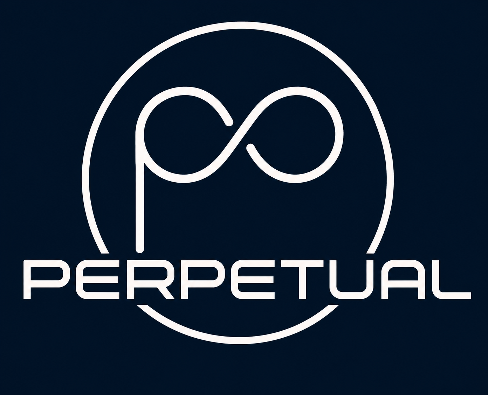
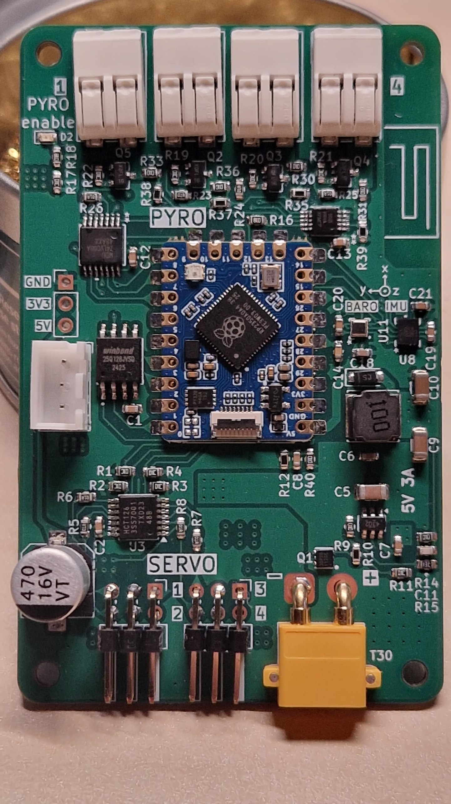
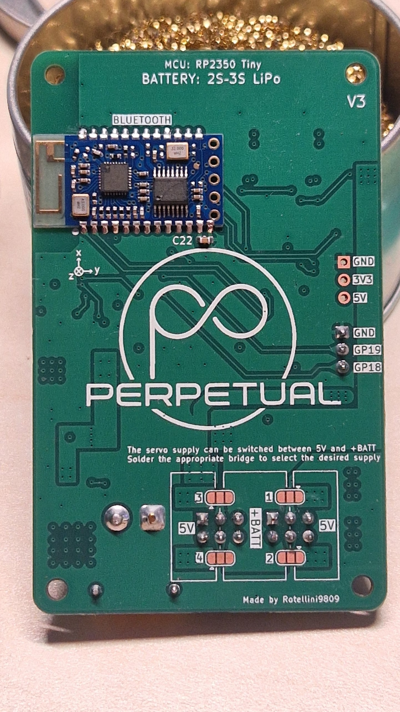
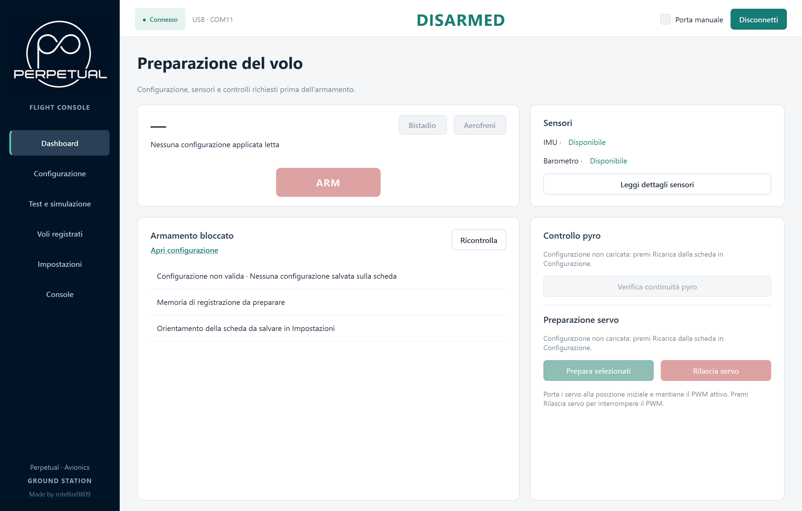
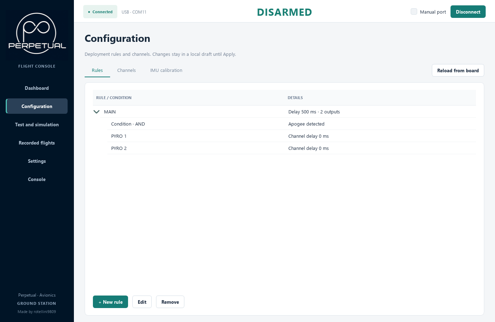

<p align="center">
  
</p>

<h1 align="center">Perpetual · Rocket Avionics</h1>

<p align="center">
  A flight computer, a custom PCB and a desktop app.<br>
  Developed for the <strong>Sapienza Rocket Team Training Academy</strong>.
</p>

<p align="center">
  
  
  
  
</p>

<p align="center">
  <a href="#the-system">The system</a> ·
  <a href="#desktop-app">Desktop app</a> ·
  <a href="#getting-started">Getting started</a> ·
  <a href="#documentation">Documentation</a> ·
  <a href="#author-and-licenses">Licenses</a>
</p>

Perpetual brings flight preparation, configurable recovery rules, simulation and post-flight
analysis into one project. Connect over **USB or Bluetooth**, prepare the board in the desktop
app, test the flight logic, and download recordings from onboard flash after the flight.
Recovery rules and device settings can be changed without rebuilding the firmware.

This repository pins the hardware and software revisions together using **Git submodules**:

| Project | What it contains |
| --- | --- |
| [perpetual_code](https://github.com/rotellini9809/perpetual_code) | Firmware, desktop app, simulation tools, tests and technical documentation |
| [perpetual_pcb](https://github.com/rotellini9809/perpetual_pcb) | KiCad schematics, PCB layout, component libraries and fabrication files |

## The system

<table>
  <tr>
    <td align="center"><br><strong>Front</strong></td>
    <td align="center"><br><strong>Back</strong></td>
  </tr>
</table>

| Hardware | Purpose |
| --- | --- |
| **Waveshare RP2350 Tiny** | Flight processing and peripheral control |
| **LSM6DSV32X IMU + BMP581 barometer** | Acceleration, angular rate, pressure and temperature |
| **16 MB SPI flash** | Onboard flight recordings, downloaded over USB or Bluetooth |
| **4 pyro channels** | Configurable recovery outputs with continuity sensing and shared hardware enable |
| **4 servo channels** | Configurable actuators; supply selectable per channel between 5 V and battery voltage |
| **USB + JDY-34 Bluetooth** | Configuration, diagnostics, simulation and flight downloads |
| **2S–3S LiPo input** | XT30 battery connection, voltage monitoring and regulated 5 V rail |

The firmware combines attitude estimation, a vertical Kalman filter and flight phase detection
for **single-stage and two-stage flights**. Recovery rules combine phase, altitude, vertical
speed and timing conditions to drive the assigned outputs. Flash recording runs on the second
core. Real sensors, hardware-in-the-loop data and onboard simulation share the navigation and
recovery logic.

**Airbrakes:** the project includes configuration and a continuous servo-control interface.
The flight-specific control law is supplied by the developer; see the [airbrake guide][airbrakes].

## Desktop app

The **Python / Qt (PySide6)** app is available in **English and Italian** and connects over
USB or paired Bluetooth. It can also be packaged as a portable Windows application.

<table>
  <tr>
    <td></td>
    <td></td>
  </tr>
  <tr>
    <td align="center"><strong>Prepare</strong> · live sensors and preflight checks</td>
    <td align="center"><strong>Configure</strong> · recovery rules and outputs</td>
  </tr>
  <tr>
    <td></td>
    <td></td>
  </tr>
  <tr>
    <td align="center"><strong>Test</strong> · onboard simulation and replay</td>
    <td align="center"><strong>Review</strong> · recordings, downloads and plots</td>
  </tr>
</table>

Set the board orientation and flight mode, configure recovery rules and servo endpoints, then
validate and apply the plan. Use simulation to exercise the configuration and the Dashboard to
review readiness before arming. After a flight, download its data and inspect the plots.

The illustrated **[app guide][app-guide]** walks through this workflow, including IMU calibration
and flight preparation. Screenshots above are reproduced from the pinned software revision;
their values illustrate the interface.

## Getting started

### 1. Clone the complete project

```sh
git clone --recurse-submodules https://github.com/Sapienza-Rocket-Team/Perpetual_training_accademy_avionics.git
cd Perpetual_training_accademy_avionics
```

If you already cloned without submodules, run from this repository's root:

```sh
git submodule update --init --recursive
```

To update an existing checkout to the revisions selected by this repository:

```sh
git pull --ff-only
git submodule update --init --recursive
```

These commands use the **pinned commits**. `git submodule update --remote` instead follows
upstream branches and is intended for maintainers choosing new revisions.

Links in this README open the latest documentation on each repository's `main` branch, which can be
ahead of the pinned commits.

### 2. Build and upload the firmware

Install **PlatformIO Core**, or the PlatformIO extension for VS Code. Connect the board with
the **RP2350 Tiny flex cable and USB-C adapter**, then run:

```powershell
cd perpetual_code
pio run
pio run --target upload
```

The default entry point is `MAIN`; PlatformIO installs the pinned platform and libraries.
If the board is not detected, hold **BOOT** while connecting USB and retry the upload.
See the [firmware quick start][firmware] for setup and diagnostics.

### 3. Run the app

With **Python 3.13** installed, run these PowerShell commands from `perpetual_code`:

```powershell
python -m venv .venv
.\.venv\Scripts\python.exe -m pip install -r perpetual_app/requirements.txt
.\.venv\Scripts\python.exe perpetual_app/main.py
```

For later launches, only the last command is needed. Close the serial monitor before connecting
the app. It searches USB first, then Bluetooth; for Bluetooth, pair the board in Windows first.
The app starts in English; choose Italian under **Settings → Language**.

### 4. Explore the hardware

Open `perpetual_pcb/perpetual_pcb.kicad_pro` in **KiCad 10**. The hardware repository includes
the schematics, four-layer layout, project libraries and Gerber/drill files. Read its
[hardware README][hardware] for connectors, servo supply bridges, programming and manufacturing.

## Documentation

| Start here | Reference |
| --- | --- |
| Prepare and use the board | [App guide][app-guide] |
| Browse firmware and app documentation | [Documentation map][docs] |
| Build, test and run diagnostics | [Test guide][tests] |
| Review recorded verification results | [Validation][validation] |
| Find pin assignments, board circuits and sensor details | [Hardware reference][pinout] |
| Check board size and mounting holes | [Mechanical drawing][mechanical] |
| Inspect or manufacture the PCB | [Hardware project][hardware] |

Documentation links open each repository's `main` branch.

## Author and licenses

Created by **Simone Cargnin ([rotellini9809](https://github.com/rotellini9809))** for the
**Sapienza Rocket Team Training Academy**. Copyright © 2026 Simone Cargnin.

| Material | License |
| --- | --- |
| Original firmware, desktop app and software materials | [PolyForm Noncommercial 1.0.0][software-license], with required attribution in [NOTICE][software-notice] |
| Original hardware design files and documentation | [CC BY-NC-SA 4.0][hardware-license] |

Each submodule retains its own license, and third-party materials retain theirs. Hosting this
integration repository under Sapienza Rocket Team does not transfer ownership of the original
projects. Image sources and attribution are listed in [docs/images/NOTICE](docs/images/NOTICE).

For commercial permissions, contact **rotellini9809@gmail.com**. Notification of research use
is appreciated at the same address; it is voluntary, not a license condition.

[firmware]: https://github.com/rotellini9809/perpetual_code#quick-start
[hardware]: https://github.com/rotellini9809/perpetual_pcb/tree/main
[app-guide]: https://github.com/rotellini9809/perpetual_code/blob/main/docs/APP_GUIDE.md
[airbrakes]: https://github.com/rotellini9809/perpetual_code/blob/main/docs/technical/AIRBRAKES.md
[docs]: https://github.com/rotellini9809/perpetual_code/blob/main/docs/README.md
[tests]: https://github.com/rotellini9809/perpetual_code/blob/main/docs/testing/README.md
[validation]: https://github.com/rotellini9809/perpetual_code/blob/main/docs/testing/VALIDATION.md
[pinout]: https://github.com/rotellini9809/perpetual_code/blob/main/docs/HARDWARE.md
[software-license]: https://github.com/rotellini9809/perpetual_code/blob/main/LICENSE
[software-notice]: https://github.com/rotellini9809/perpetual_code/blob/main/NOTICE
[mechanical]: https://github.com/rotellini9809/perpetual_pcb#mechanical
[hardware-license]: https://github.com/rotellini9809/perpetual_pcb/blob/main/LICENSE
