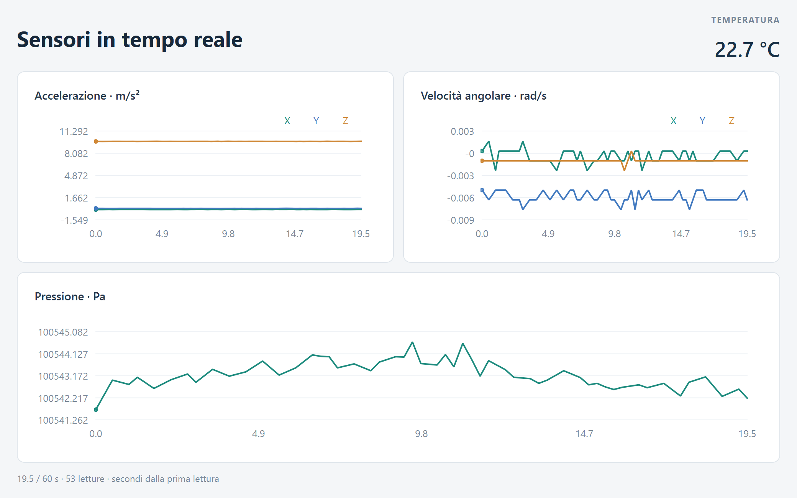
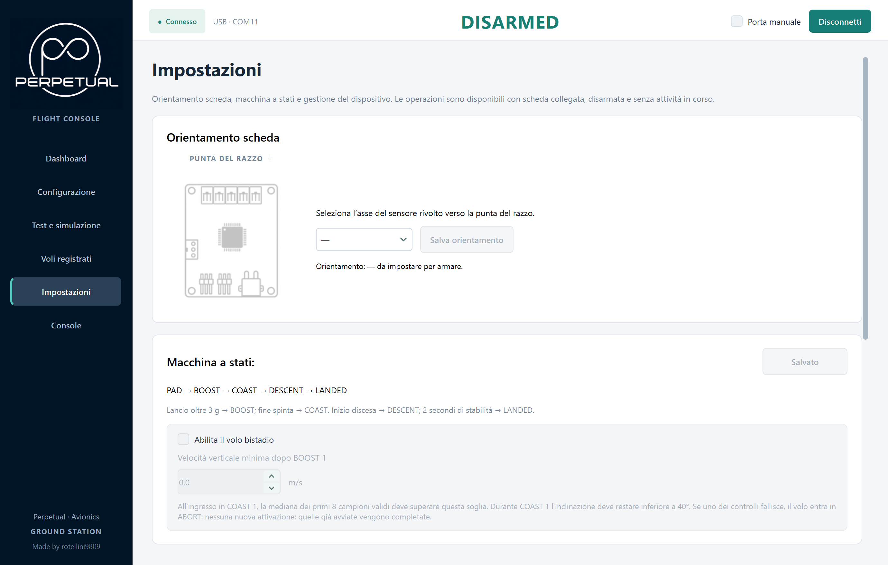
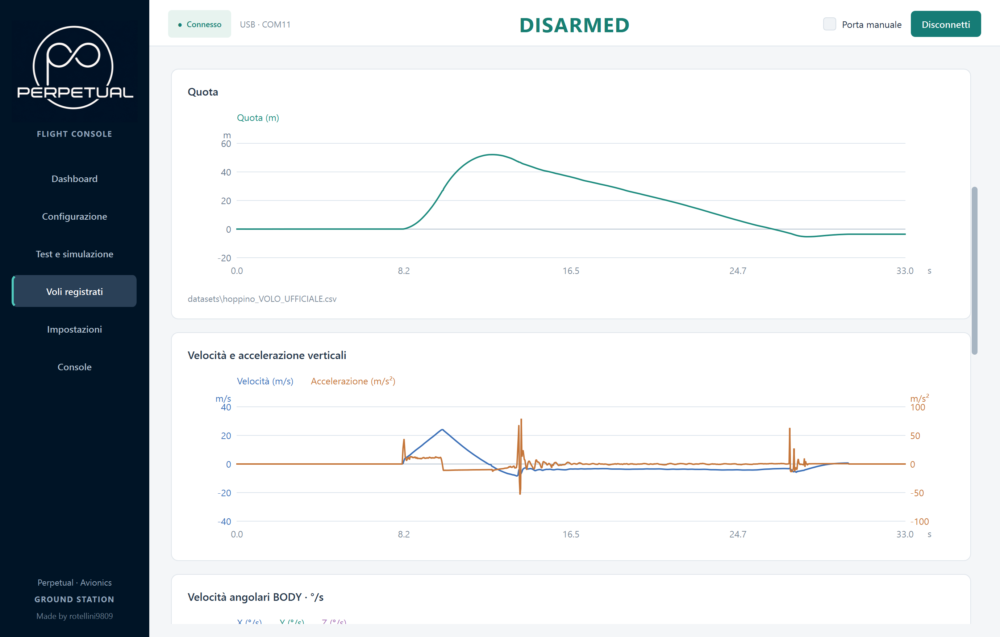
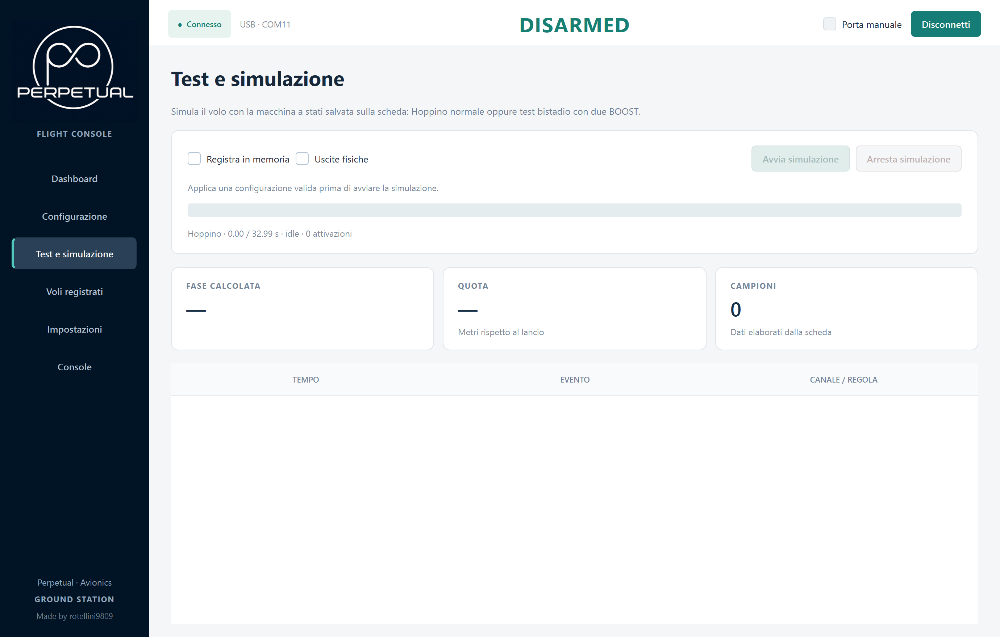

<p align="center">
  
</p>

<h1 align="center">Perpetual · Rocket Avionics</h1>

<p align="center">
  Flight computer, custom PCB and desktop Flight Console<br>
  Built for the <strong>Sapienza Rocket Team Training Academy</strong>
</p>

<p align="center">
  <a href="#flight-console">Explore the app</a> ·
  <a href="#getting-started">Getting started</a> ·
  <a href="#hardware-and-source">Hardware & source</a> ·
  <a href="#license-and-attribution">Licensing</a>
</p>

Perpetual brings flight preparation, recovery rules, onboard simulation and post-flight analysis into one workflow. Connect the board over USB or paired Bluetooth SPP, configure it through the Flight Console, and inspect its sensor data and recorded flights. Deployment rules and device settings can be changed without reflashing the firmware.

| Prepare | Experiment | Review |
| --- | --- | --- |
| Configure pyro and servo channels, combine deployment conditions and review firmware preflight checks. | Inspect live IMU/barometer data and exercise the flight logic with onboard simulation. | Download recordings or open a local CSV to explore altitude, motion, orientation and output events. |

## Flight Console

The Python / Qt application follows the workflow from bench setup to flight review. Its interface is currently in Italian; the labels below match the app.

### Live sensor inspection

Open **Dashboard → Leggi dettagli sensori** for acceleration and angular-rate plots on all three axes, pressure and temperature. The history expands to a rolling 60-second window.



*Actual USB measurements from the connected board: accelerometer, gyroscope and barometer. Captured on 17 November 2026.*

### Configure, prepare and inspect

<table>
  <tr>
    <td width="50%"><strong>Configuration · deployment rules</strong><br><a href="docs/images/configuration.png"></a></td>
    <td width="50%"><strong>Dashboard · flight preparation</strong><br><a href="docs/images/dashboard.png"></a></td>
  </tr>
  <tr>
    <td width="50%"><strong>Settings · orientation and flight mode</strong><br><a href="docs/images/settings.png"></a></td>
    <td width="50%"><strong>Flight review · altitude and vertical motion</strong><br><a href="docs/images/flight-plots.png"></a></td>
  </tr>
</table>

*Click an image for full size. Configuration shows illustrative local drafts, not a flight prescription or settings applied to the board. Dashboard and Settings show the board before initial setup. Flight review uses the included Hoppino CSV, opened locally; phase overlays are disabled for this legacy log.*

| App section | What you can do |
| --- | --- |
| **Dashboard** | Read sensor availability and applied configuration, inspect preflight blockers, check configured pyro continuity and prepare assigned servos. ARM requires a 1.5-second hold; the firmware decides readiness. |
| **Configurazione** | Assign four pyro and four servo channels. Build AND conditions from flight phase, apogee, altitude, vertical speed and elapsed time; set rule and channel delays. Changes remain a local draft until validated and applied. |
| **Test e simulazione** | Run the embedded Hoppino profile in normal mode or a two-boost profile in bistage mode. Follow progress, phase and output events. Recording and physical outputs are explicit options; physical outputs are unchecked by default. |
| **Voli registrati** | List and download onboard recordings or open a local CSV. Inspect altitude, vertical velocity/acceleration, angular rates, Euler orientation and battery plots, with available phase and actuator overlays. |
| **Impostazioni** | Set board orientation, normal/two-stage flight mode and airbrake enable. Device reset and flight-memory formatting are separate operations. |
| **Console** | Inspect command/reply traffic and send firmware commands for diagnostics. |

<details>
<summary><strong>See the simulation screen</strong></summary>



The selected flight mode determines the profile. This screenshot shows the controls before a run.

</details>

**Airbrakes:** the app configures dedicated servo channels, endpoints and a continuous AND gate, and displays recorded commanded openings. The control law lives in the firmware; the supplied default law commands zero opening. See the [airbrake integration guide](https://github.com/rotellini9809/perpetual_code/blob/main/docs/technical/AIRBRAKES.md) when implementing a controller.

## Getting started

### 1. Clone the complete project

```sh
git clone --recurse-submodules https://github.com/Sapienza-Rocket-Team/Perpetual_training_accademy_avionics.git
cd Perpetual_training_accademy_avionics
```

Already cloned without submodules?

```sh
git submodule update --init --recursive
```

After pulling an update to this repository, run the same submodule command to check out its pinned software and hardware revisions.

### 2. Launch the desktop app

On Windows, with Python installed, run these commands in PowerShell:

```powershell
cd perpetual_code
python -m venv .pio/perpetual_app_venv
.\.pio\perpetual_app_venv\Scripts\python.exe -m pip install -r perpetual_app/requirements.txt
.\.pio\perpetual_app_venv\Scripts\python.exe perpetual_app/main.py
```

Environment creation and dependency installation are needed only for the initial setup. For later launches, run the last command from `perpetual_code`.

### 3. Connect and prepare

Connect a board running the **MAIN** firmware and close any Serial Monitor using its port. The app makes one automatic connection attempt, searching USB first and then paired outgoing Bluetooth SPP ports. Use **Connetti** to try again, or **Porta manuale** to select a port explicitly.

1. Open **Impostazioni** to select and save board orientation and the intended flight mode.
2. Open **Configurazione** to define deployment rules and servo endpoints, then **Valida → Applica**.
3. Return to **Dashboard** and use **Ricontrolla** to read the board's preflight requirements and complete the indicated preparation.
4. Use **Test e simulazione** to explore the configured flight logic, then **Voli registrati** to inspect recordings or local CSV files.

For firmware builds, select `-D MAIN` in the submodule's `platformio.ini`, with other entry-point flags disabled. From `perpetual_code`, use `pio run` to build and `pio run --target upload` to flash the board. See the [software documentation](https://github.com/rotellini9809/perpetual_code/blob/main/docs/README.md) for setup, storage preparation and diagnostics.

## Hardware and source

| Component | Platform |
| --- | --- |
| Microcontroller | Waveshare RP2350 Tiny / Arduino-Pico |
| Inertial sensing | ST LSM6DSV32X IMU |
| Barometric sensing | Bosch BMP581 |
| Flight storage | W25Q128JV SPI flash · 16 MiB |
| Connectivity | USB serial and JDY-34 Bluetooth SPP |
| Outputs | Four pyro channels with continuity checks and four servo PWM channels |

This repository brings together two independently maintained projects as Git submodules:

| Repository | Contents | License |
| --- | --- | --- |
| [perpetual_code](https://github.com/rotellini9809/perpetual_code) | Firmware, Flight Console, replay tools, tests and technical documentation | PolyForm Noncommercial 1.0.0 |
| [perpetual_pcb](https://github.com/rotellini9809/perpetual_pcb) | KiCad schematics, PCB layout and hardware assets | CC BY-NC-SA 4.0 |

Useful references: [hardware and pin map](https://github.com/rotellini9809/perpetual_code/blob/main/docs/HARDWARE.md) · [configuration rules](https://github.com/rotellini9809/perpetual_code/blob/main/docs/technical/CONFIGURATION.md) · [recording and download](https://github.com/rotellini9809/perpetual_code/blob/main/docs/testing/RECORDING.md) · [USB/Bluetooth protocol](https://github.com/rotellini9809/perpetual_code/blob/main/docs/technical/USB.md).

## License and attribution

Perpetual was created by **Simone Cargnin ([rotellini9809](https://github.com/rotellini9809))** for the **Sapienza Rocket Team Training Academy**. Hosting this integration repository under Sapienza Rocket Team does not transfer ownership of the original projects.

- Original software: [PolyForm Noncommercial 1.0.0](https://github.com/rotellini9809/perpetual_code/blob/main/LICENSE), with attribution in [NOTICE](https://github.com/rotellini9809/perpetual_code/blob/main/NOTICE).
- Original hardware design files and documentation: [CC BY-NC-SA 4.0](https://github.com/rotellini9809/perpetual_pcb/blob/main/LICENSE).
- Each submodule retains its own license. Third-party materials retain their respective licenses. The logo and app screenshots are reproduced from the Perpetual software project.

For commercial licensing inquiries, contact **rotellini9809@gmail.com**. If you use Perpetual in research, notification at the same address is appreciated; it is a voluntary request, not a license condition.
